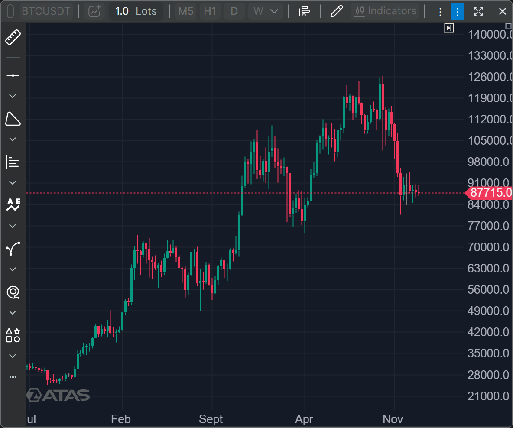
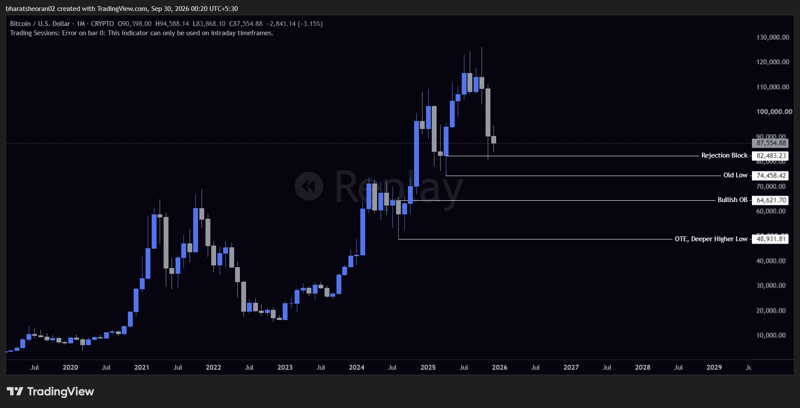
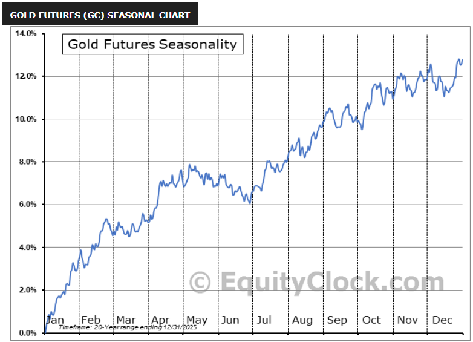
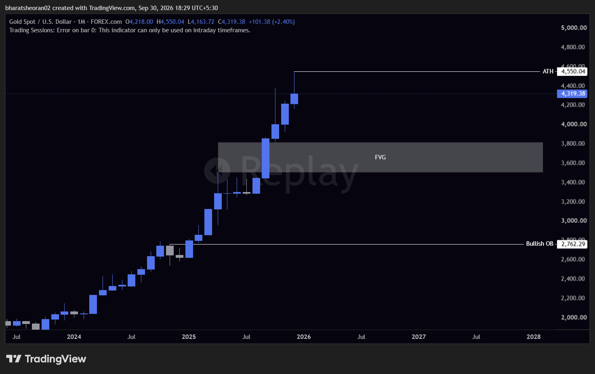
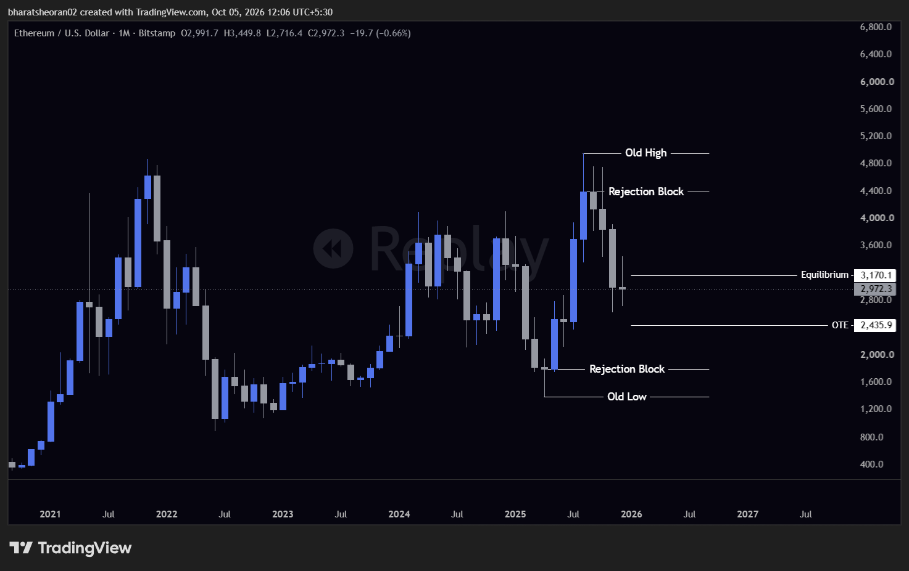
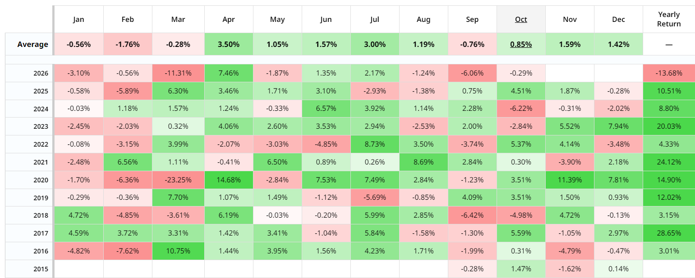
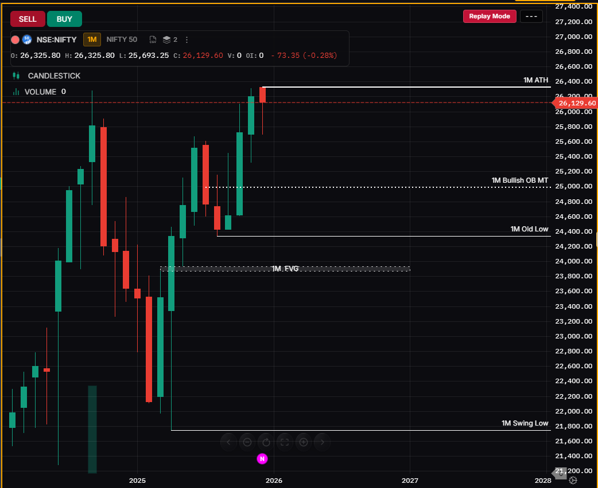

# 📅 Monthly Bias — JANUARY 2026

  

> Top-down bias review — filled in at the start of the month, revisited as the month develops.

---

## 🧭 Quick Summary

| Symbol | Net Bias |
|---|---|
| Bitcoin | Bearish |
| Gold | Bullish |
| Etherium | Bearish |
| Nifty | |
| Sensex | |

---

<!-- #region Bitcoin -->

<h3>₿ Bitcoin</h3>

### 🍂 Seasonal Tendency
> ![Bitcoin] From Last Five Years, January month is either Downtrend or Consolidation  
PS: Bitcoin don't follow seasonal tendencies, but it's good for Ideation of the price

### 🔄 Quarterly Shifts
> From Monthly Perspective, BTC is in Retest zone near the Last Lower High

### 💱 Interest Rate Differentials
> For Gold and Nifty Trades, Doesn't Matter for Bitcoin

### 🧩 PD Array Matrix
> Rejection Block @ 82,483  
Old Low @ 74,458  
Bullish OB @ 64,621  
OTE + Deeper Higher Low @ 48,931  

### 🏗️ Market Structure
> HTF has seen a Retesting in the price

### 📊 Market Profile
> Market is in discount zone relative to last Higher Low

### 🎯 Key Price Levels
> Rejection Block @ 82,483  
Old Low @ 74,458  
Bullish OB @ 64,621  
OTE + Deeper Higher Low @ 48,931  

### 🧠 Monthly Bias Defined
> For this Month we will stay bearish on Monthly Basis

<!-- #endregion -->
---

<!-- #region Gold -->

<h3>🥇 Gold</h3>

### 🍂 Seasonal Tendency
> Gold is Strongly bullish in January from last 20Years, So I am expecting 3% move in this month

### 🔄 Quarterly Shifts
> From past 4 Months, Gold is in Strong Uptrend

### 💱 Interest Rate Differentials
> Will fill out later

### 🧩 PD Array Matrix
> Gold is at All Time High  
All Time High @ $4,550.04  
FVG b/w @ $3,507.10 to $3,815.65  
Bullish OB at @ $2,762.29  

### 🏗️ Market Structure
> Market Structure is Bullish, Gold is constantly making HH and HL

### 📊 Market Profile
> Bullish

### 🎯 Key Price Levels
> All Time High @ $4,550.04  
FVG b/w @ $3,507.10 to $3,815.65  
Bullish OB at @ $2,762.29  

### 🧠 Monthly Bias Defined
> Bullish

<!-- #endregion -->

---

<!-- #region Etherium -->

<h3>🔶 Etherium</h3>

### 🍂 Seasonal Tendency
> January shows both Bullish and Bearish Returns in January Month, We need to find bias from other aspects.

### 🔄 Quarterly Shifts
> From Monthly Chart, I can clearly see a bearish run.

### 💱 Interest Rate Differentials
> There is less Interest Rate affect on Crypto

### 🧩 PD Array Matrix
> Etherium

### 🏗️ Market Structure
> Right Now, Market is in Discount zone below Equilibrium of last Swing and in Bearish Retesting.

### 📊 Market Profile
> Bearish

### 🎯 Key Price Levels
> *** Premium Arrays ***
Old High @ $4955.3  
Rejection Block @ $4393.1  
Equilibrium @ $3170.1

*** Discount Arrays ***
OTE @ $2435.9  
Rejection Block @ $1794.0
Old Low @ $1385.7

### 🧠 Monthly Bias Defined
> Bearish

<!-- #endregion -->

---

<!-- #region Nifty -->

<h3>🇮🇳 Nifty</h3>

### 🍂 Seasonal Tendency
> Nifty Last 10 Years average for January is -0.5%, and In January Market keeps in consolidated bearish Zone.

### 🔄 Quarterly Shifts
> Last 4 Months Shown aggresive Bull runs, so I can see that January can be a consolidated bearish month

### 💱 Interest Rate Differentials
> During this period, the interest rate differential between India's repo rate and the upper bound of the U.S. fed funds rate stood at a narrow 1.50% (5.25% minus 3.75%).

### 🧩 PD Array Matrix
> 

### 🏗️ Market Structure
> Market is in Bullish Structure, Making HH and HL

### 📊 Market Profile
> Bullish

### 🎯 Key Price Levels
> All time High @ 26325Rs  
Bullish OrderBlock Mean Threshold @ 25000Rs 
FVG Near 23900Rs 
Swing Low @ 23740Rs

### 🧠 Monthly Bias Defined
> As Market is in Premium zone and Jan stays consolidated bearish, Monthly Bias is Bearish.

<!-- #endregion -->

---

<!-- #region Sensex -->

<h2>🇮🇳 Sensex</h2>

### 🍂 Seasonal Tendency
> 

### 🔄 Quarterly Shifts
> 

### 💱 Interest Rate Differentials
> 

### 🧩 PD Array Matrix
> 

### 🏗️ Market Structure
> 

### 📊 Market Profile
> 

### 🎯 Key Price Levels
> 

### 🧠 Monthly Bias Defined
> 

<!-- #endregion -->

---