## 🧭 Quick Summary

| Symbol | Result |
|---|---|
| Bitcoin | Bias correct, entry never triggered |
| Gold | |
| BNBUSD | |
| Nifty | |
| Sensex | |

---

<!-- #region Bitcoin -->

<h3>₿ Bitcoin</h3>

### 💪 4Hr Perspective
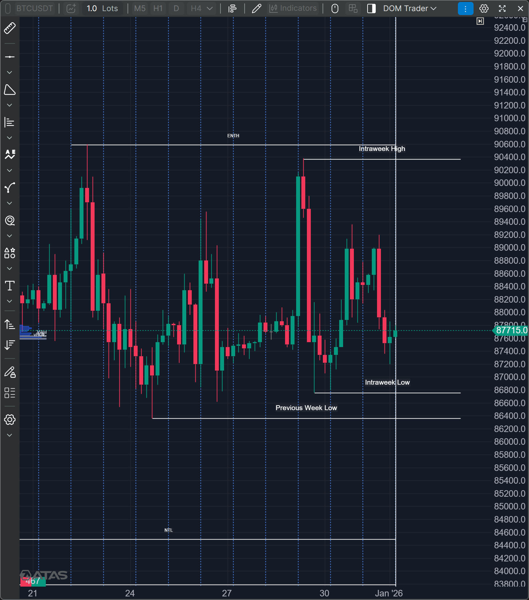

#### PD Arrays
> Intraweek High  
Intraweek Low  
ENTH, Previous Week High  
Previous Week Low  

### 💪 1Hr Perspective
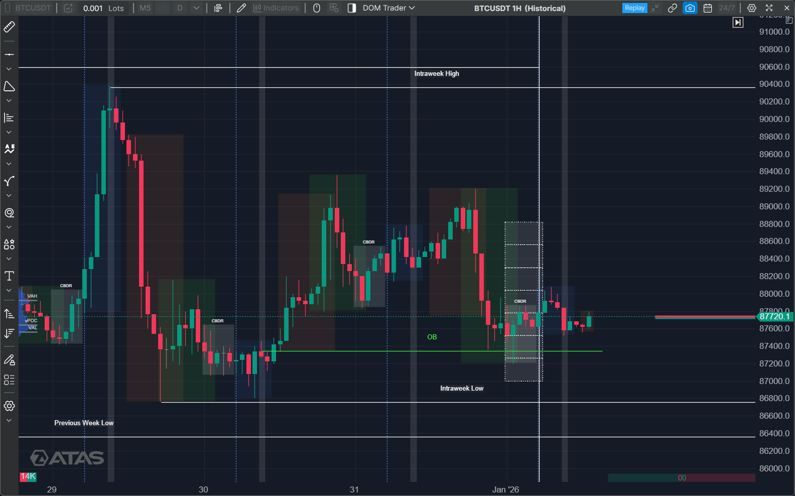

#### PD Arrays
> 1Hr OB near the Rejection Block  
Entry Near -1.5 CBDR Range, Target till 4CBDR  

### 💪 15Min Perspective
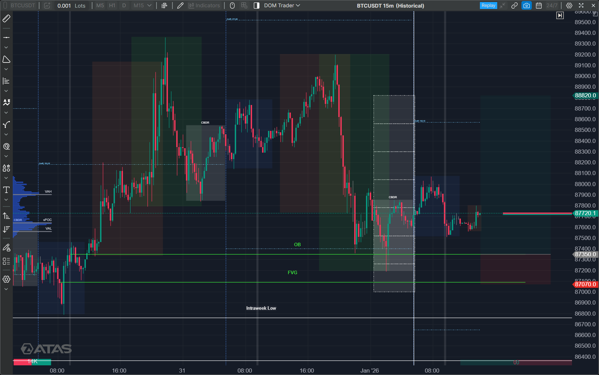

#### PD Arrays
> FVG Marked by green line  

### 🎯 Entry
> Entry is on Breaker Block  
StopLoss below FVG  
Target to 4CBDR  

### ✅ Trade Result
> Bias was correct, but market never reached till the entry point  
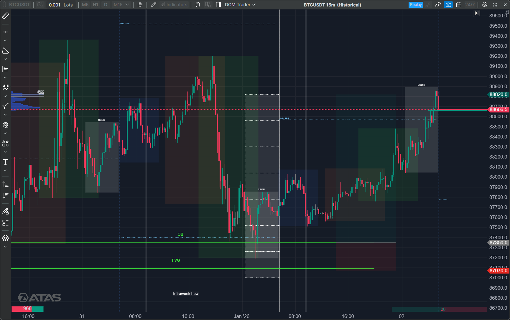

<!-- #endregion -->
---

<!-- #region Gold -->

<h3>🥇 Gold</h3>

### 💪 4Hr Perspective
> 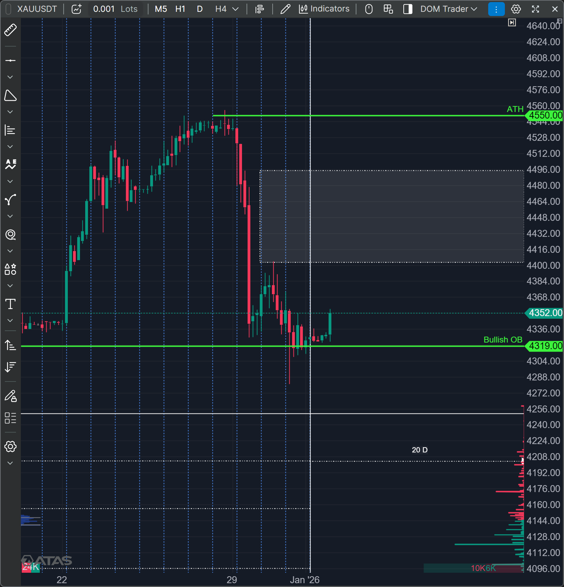

#### PD Arrays
> Same Marked in IPDA, No extra PD Arrays

### 💪 1Hr Perspective
> 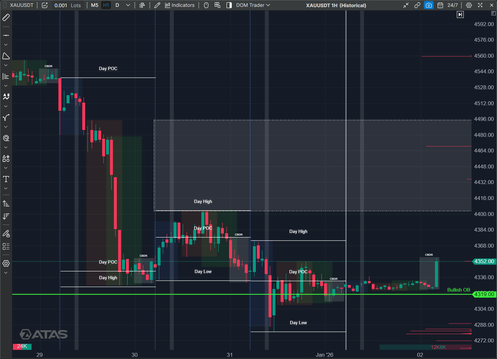

#### PD Arrays
> Daily Highs, and Lows Marked with CBDR ranges

### 💪 15Min Perspective
> 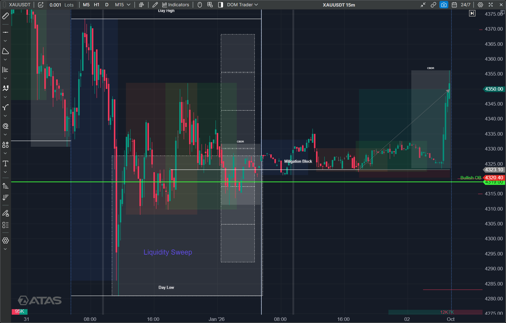

#### PD Arrays
> Mitigation Block @ 4323.10$

### 🎯 Entry
> IntraWeek Liquidity Sweep done in Gold, Looking for an entry from Mitigation Block, The price is lower than the highest Mitigation Block, so I took an entry on lower Mitigation block, Stop Loss is below asian Session, Target is 2 CBDR, previous London Session high

### ✅ Trade Result
> Trade Bias was correct, ends with 1:10 Risk to Reward

<!-- #endregion -->
---

<!-- #region Etherium -->

<h3>🔶 ETHUSD</h3>

### 💪 4Hr Perspective
> 4 Hr is in Consolidation, No Extra PD Arrays than IPDA
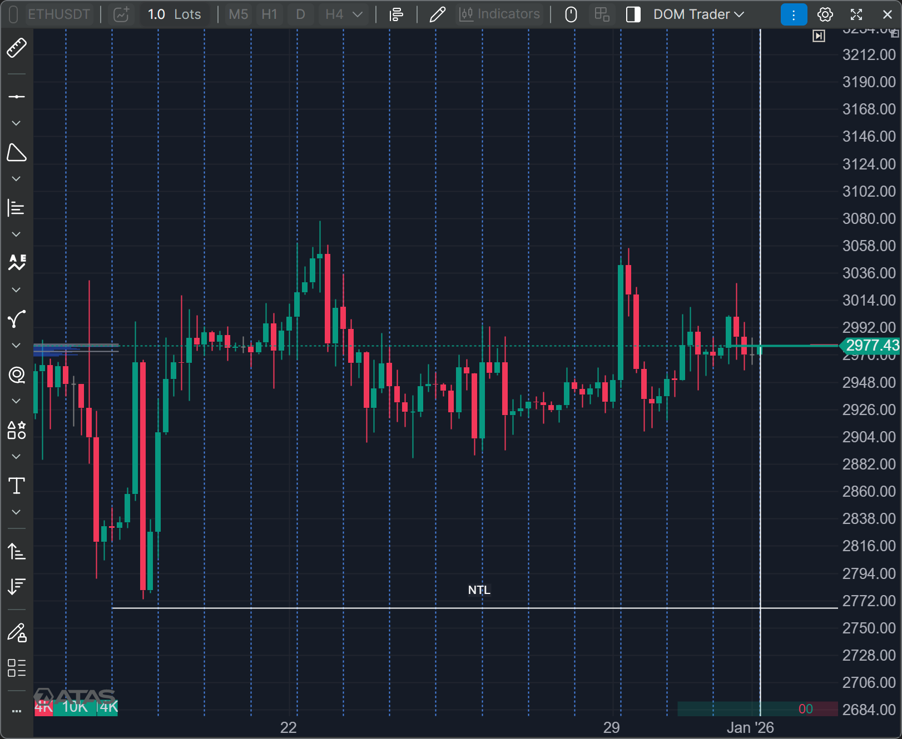

#### PD Arrays
> No Extra PD Arrays

### 💪 1Hr Perspective
> 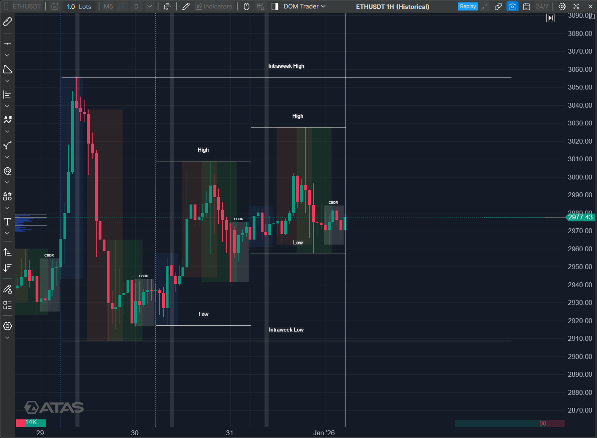

#### PD Arrays
> Day's High and Low + Intraweek High & Low  
Week High and low Built on Monday.
Daily High and Low is marked on Overlapping zone of London and New york

### 💪 15Min Perspective
> 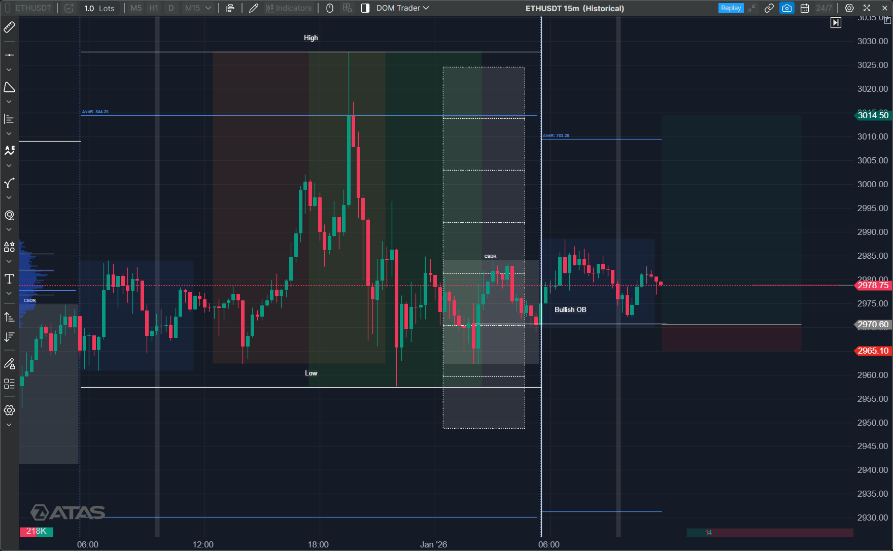

#### PD Arrays
> Bullish Orderblock & Liquidity Pool just above the Bullish Orderblock.

### 🎯 Entry
> Entry is on the Bullish Orderblock, Stoploss is till body of the orderblock and target is Previous day high rejection block.

### ✅ Trade Result
> Bias was Correct, but move was not till my target, Also price didn't take my entry and Price respected asian Low.
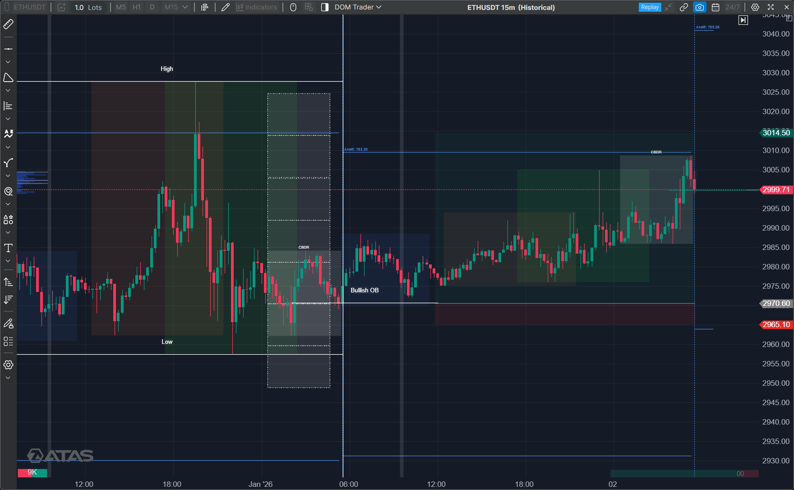

<!-- #endregion -->
---

<h2>🇮🇳 Nifty</h2>

### 💪 4Hr Perspective
> 

#### PD Arrays
> 

### 💪 1Hr Perspective
> 

#### PD Arrays
> 

### 💪 15Min Perspective
> 

#### PD Arrays
> 

### 🎯 Entry
> 

### ✅ Trade Result
> 

---

<h2>🇮🇳 Sensex</h2>

### 💪 4Hr Perspective
> 

#### PD Arrays
> 

### 💪 1Hr Perspective
> 

#### PD Arrays
> 

### 💪 15Min Perspective
> 

#### PD Arrays
> 

### 🎯 Entry
> 

### ✅ Trade Result
> 

