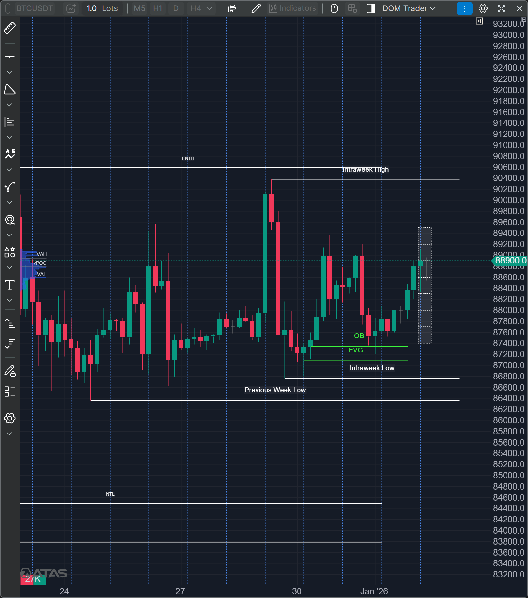
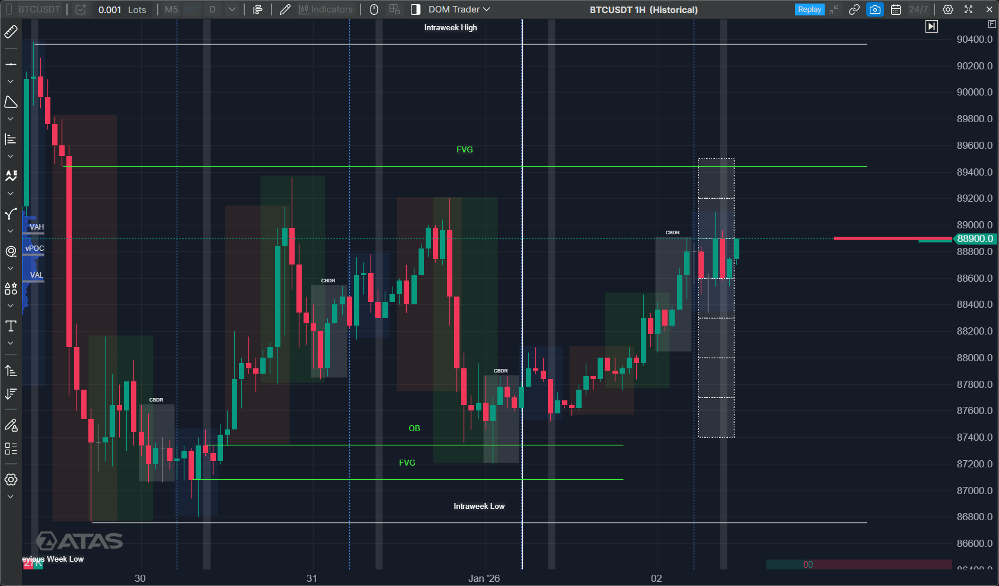
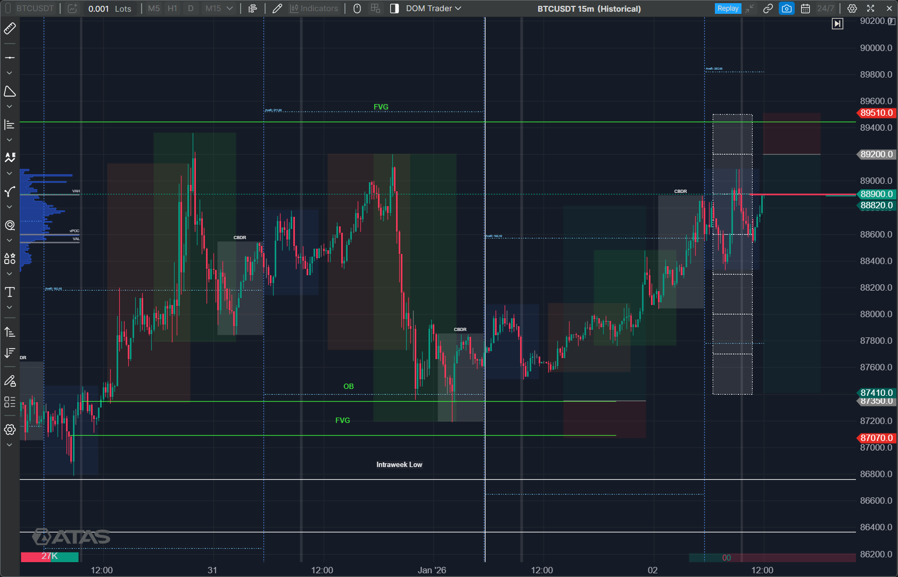
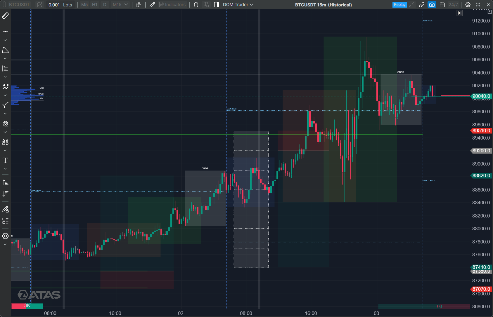

## 🧭 Quick Summary

| Symbol | Result |
|---|---|
| Bitcoin | Bias was Incorrect, Market stays bullish |
| Gold | |
| BNBUSD | |
| Nifty | |
| Sensex | |

---

<h2>₿ Bitcoin</h2>

### 💪 4Hr Perspective
> Bitcoin

#### PD Arrays
> Intraweek High  
Intraweek Low  
ENTH, Previous Week High  
Previous Week Low  

### 💪 1Hr Perspective
> Bitcoin

#### PD Arrays
> 1Hr FVG near the Rejection Block  
Entry On the Mean Threshold of Rejection Block, StopLoss above the FVG, Target till 4Asian Range STD  

### 💪 15Min Perspective
> Bitcoin

#### PD Arrays
> FVG Marked by green line  

### 🎯 Entry
> Entry is on Mean Threshold of Rejection Block  
StopLoss above FVG  
Target to 4CBDR  

### ✅ Trade Result
> Bitcoin  
Bias was Incorrect, Market stays bullish, respects the Asian range low both in London as well as in New York session  

---