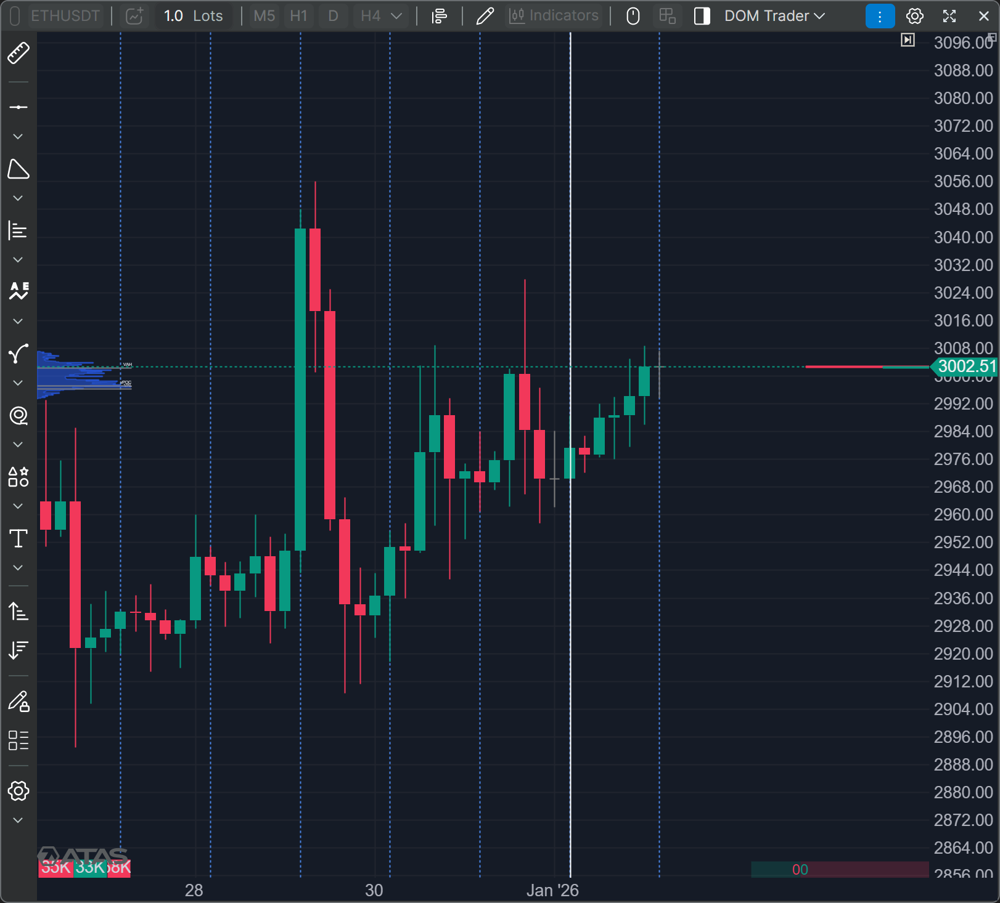
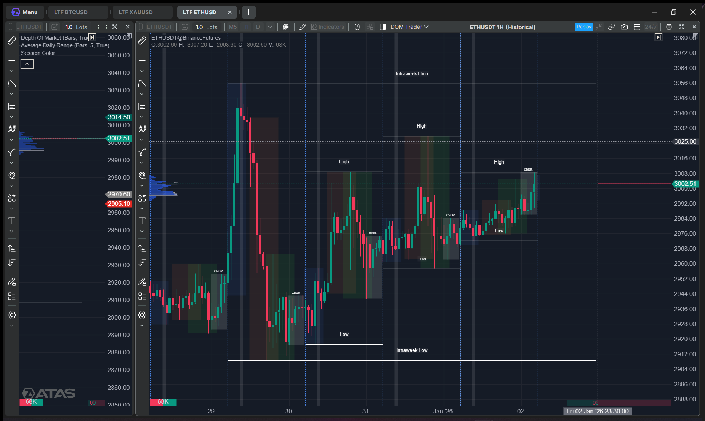
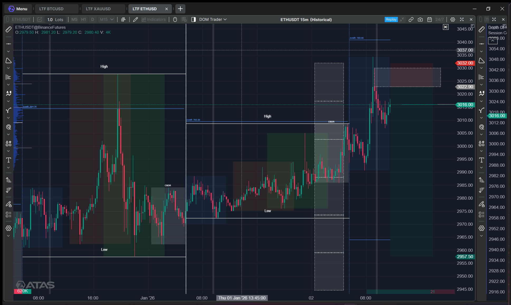
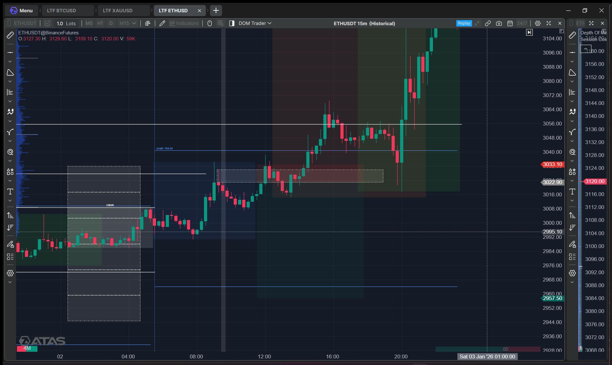

## 🧭 Quick Summary

| Symbol | Result |
|---|---|
| Bitcoin | Bias was Incorrect, Market stays bullish |
| Gold | No Data Availaible |
| BNBUSD | |
| Nifty | |
| Sensex | |

---

<!-- #region Bitcoin -->

<h3>₿ Bitcoin</h3>

### 💪 4Hr Perspective
> Bitcoin

#### PD Arrays
> Intraweek High  
Intraweek Low  
ENTH, Previous Week High  
Previous Week Low  

### 💪 1Hr Perspective
> Bitcoin

#### PD Arrays
> 1Hr FVG near the Rejection Block  
Entry On the Mean Threshold of Rejection Block, StopLoss above the FVG, Target till 4Asian Range STD  

### 💪 15Min Perspective
> Bitcoin

#### PD Arrays
> FVG Marked by green line  

### 🎯 Entry
> Entry is on Mean Threshold of Rejection Block  
StopLoss above FVG  
Target to 4CBDR  

### ✅ Trade Result
> Bitcoin  
Bias was Incorrect, Market stays bullish, respects the Asian range low both in London as well as in New York session  

<!-- #endregion -->

---

<!-- #region Gold -->

<h2>🥇 Gold</h2>

No Gold Data Availaible for 2 January

<!-- #endregion -->
---

<!-- #region Etherium -->

<h3>🔶 ETHUSD</h3>

### 💪 4Hr Perspective
> Last 4 candles are bullish with low momentum, So I can expect a Selling from @ 3002

#### PD Arrays
> Right now Price is at Rejection block and is going towards Old High.  
Rejection Block @3000  
Old High @3028

### 💪 1Hr Perspective
> Intraweek and Previous Week High and Low is not broken yet, Price is at Premium side of Intraweek range.

#### PD Arrays
> Day Highs and lows + Intraweek Highs & Lows

### 💪 15Min Perspective
> 

#### PD Arrays
> Rejection Block @ 3022

### 🎯 Entry
> Entry on Rejection Block as Market took the inner Liquidity of Intraweek, I can aspect a Selling from the rejection block, Target is 4 CBDR and low of the Intraweek. Stoploss is the high of the rejection block.

### ✅ Trade Result
> Bias was Incorrect

<!-- #endregion -->
---

<h2>🇮🇳 Nifty</h2>

### 💪 4Hr Perspective
> 

#### PD Arrays
> 

### 💪 1Hr Perspective
> 

#### PD Arrays
> 

### 💪 15Min Perspective
> 

#### PD Arrays
> 

### 🎯 Entry
> 

### ✅ Trade Result
> 

---

<h2>🇮🇳 Sensex</h2>

### 💪 4Hr Perspective
> 

#### PD Arrays
> 

### 💪 1Hr Perspective
> 

#### PD Arrays
> 

### 💪 15Min Perspective
> 

#### PD Arrays
> 

### 🎯 Entry
> 

### ✅ Trade Result
> 

