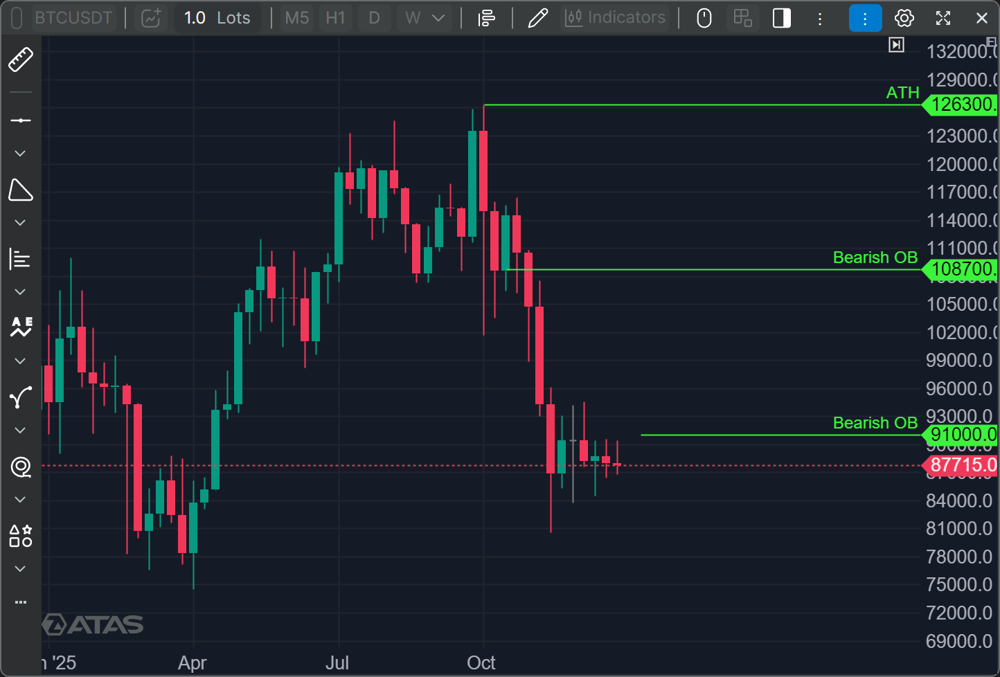
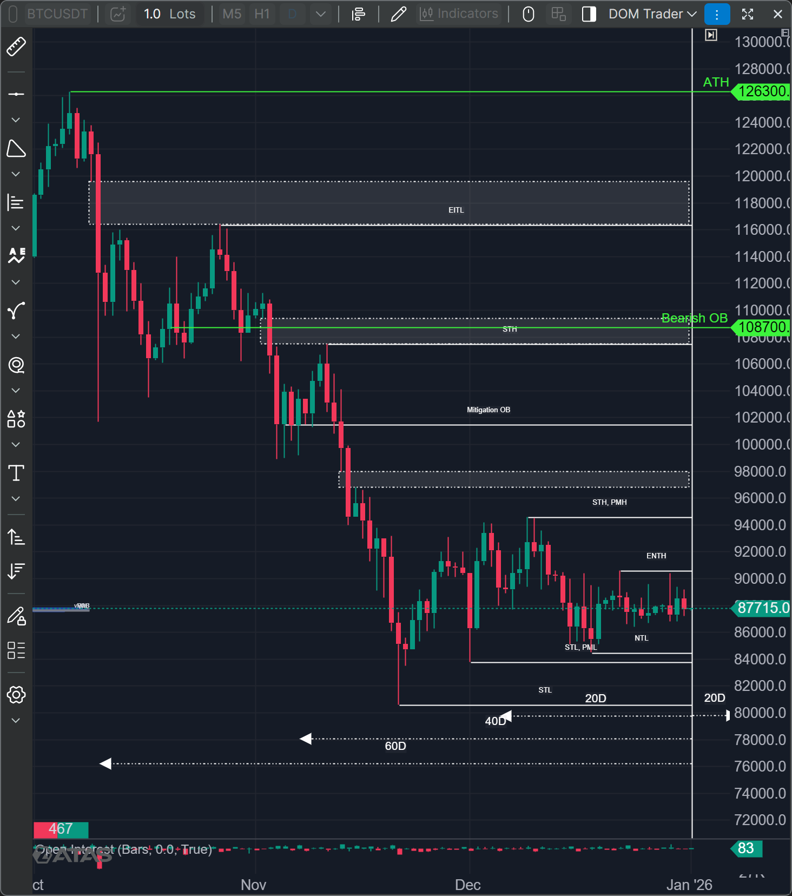

# 📆 Weekly Bias — Week of 1 Jan to 5 Jan (January 2026)

  

> Top-down weekly bias review — filled in before the week starts, revisited as the week develops.

## 💪 Relative Strength
> Skip for now

## 📑 Commitment of Traders
> Only Availaible for Gold

## 🎭 Market Sentiment
> ![Bitcoin] The "Bullish Reset" Narrative, As Bitcoin is near the Previous Higher Low, expecting a Bull run for Higher High, but for now consolidation phase is there

## 📊 Market Profile
> There is consolidation from previous 5 Weeks

## 🔗 Intermarket Analysis
> Will compare BTC with BTC.D

## 🏗️ Market Structure
> From weekly perspective, Market is in Downtrend

## 🧩 PD Array Matrix
> Bitcoin

## 🧠 Weekly Bias Defined
> Weekly bias is consolidation or bearish, No Longs for this week

## 🧠 IPDA Range PD Arrays 
> ATH -> All time High @ 126,300  
#### 60 Days  
>FVG b/w @ 119,700 to @ 116,400  
Equal Intermediate Term High @ 116400  
Weekly Bearish OB @ 108,700  
FVG b/w @ 109,400 to @ 107,500  
#### 40 Days  
>Short Term High @ 107,500  
Mitigation OB @ 101,600  
FVG b/w @ 98,000 to @ 96,700  

#### 20 Days  
>Near Term High @ 94,600  
Near Term Low @ 83,700  

