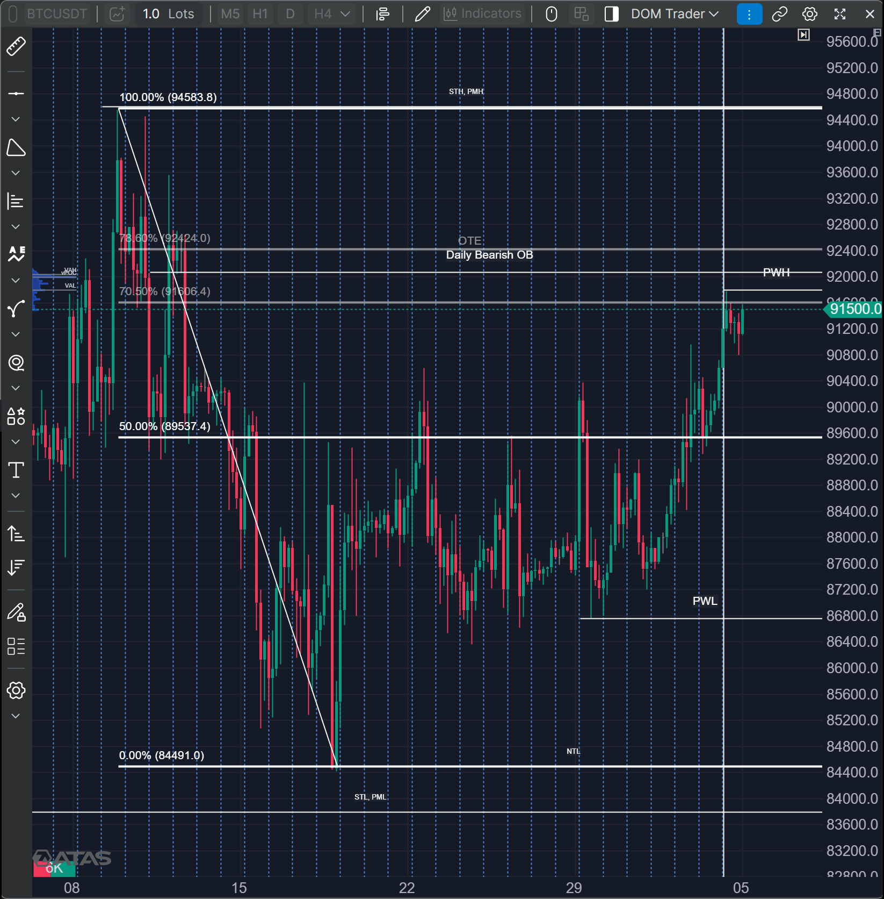
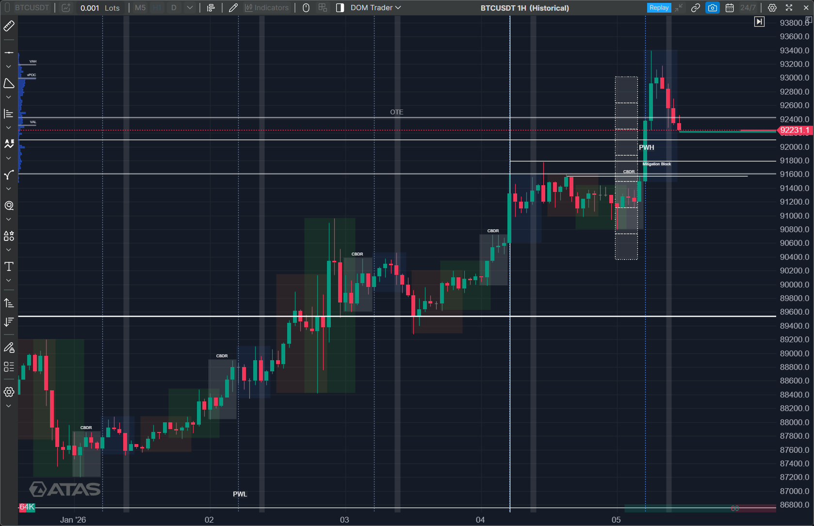
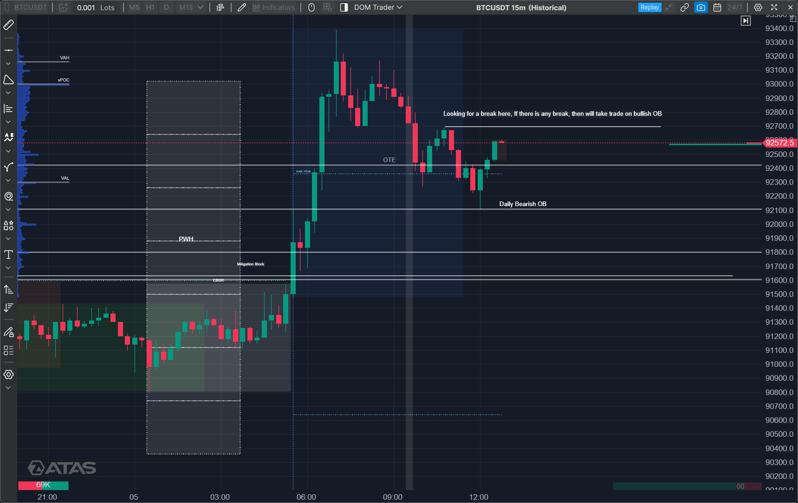
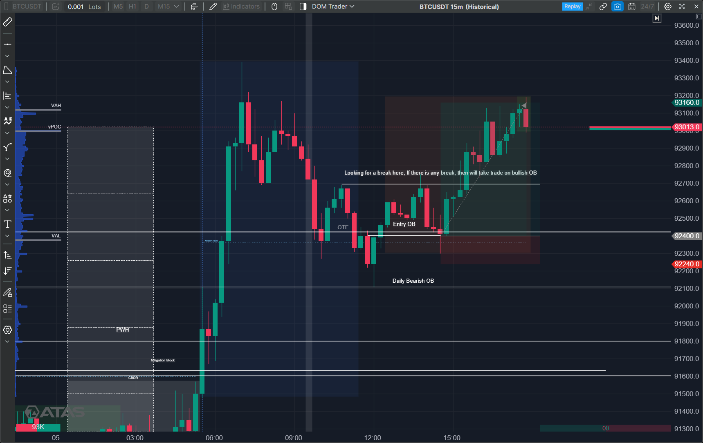
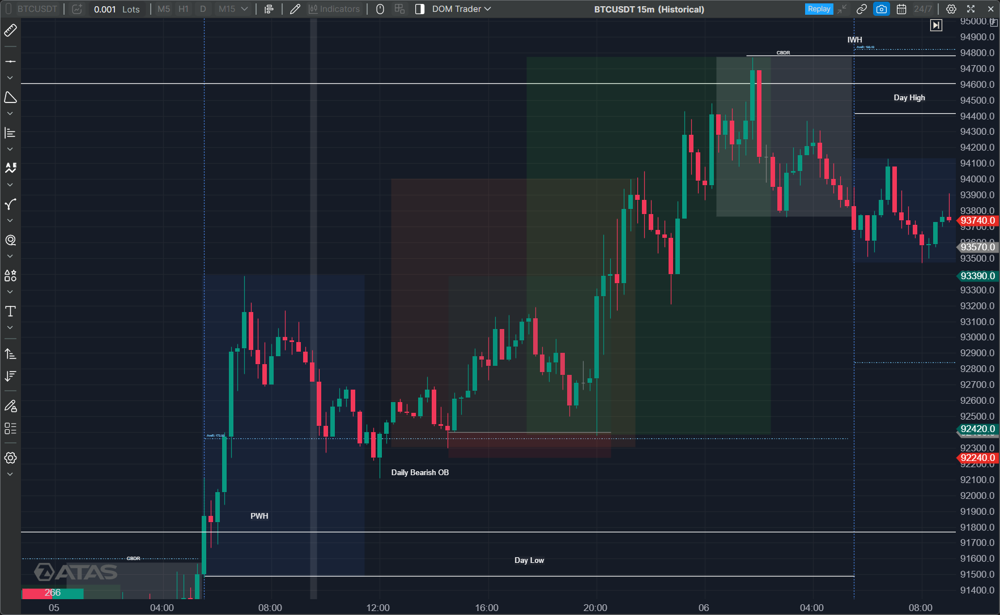

## 🧭 Quick Summary

| Symbol | Result |
|---|---|
| Bitcoin |  |
| Gold | |
| BNBUSD | |
| Nifty | |
| Sensex | |

---

<!-- #region Bitcoin -->

<h3>₿ Bitcoin</h3>

<h4>🔍 Pre-Observation</h4>

### 💪 4Hr Perspective

#### PD Arrays
> Previous Week High  
Previous Week Low  
Near OTE Levels  
Near Daily Bearish Orderblock  

### 💪 1Hr Perspective
> Looking for a Buy Setup for today as there is a mitigation block there.

#### PD Arrays
> 1Hr OB is near OTE level, but I can see a liquidity sweep on higher timeframe, so I am getting into long.  
Mitigation Block marked will be our entry zone.  

### 💪 15Min Perspective
> If there is any break we will take entry on Bullish OB, As the rejection is on the Daily bearish OB.

#### PD Arrays
> FVG Marked by green line  

### 🎯 Planned Entry
> Entry is on Bullish OB  
StopLoss below Bullish OB  
Target to next swing  

<h4>📥 Trade Taken</h4>

| Field | Details |
|---|---|
| Direction | Long |
| Entry Price | $ 92420 |
| Stop Loss | $ 92240 |
| Target | $ 93390 |
| Risk : Reward | 1:6 |
| Entry Time | 2:30 PM |
| Entry Model | Bullish OB |

#### Execution Notes
> There is Bullish OB here and took 1 Liquidity before going to the Orderblock.  

<h4>📊 Post Price Observation</h4>

#### What Price Actually Did
> Asian, London, New York respected each of them in bullish bias, Asian High Liquidity is taken by London Newyork Overlap  
New York Closing Made the High of the week.  

#### Pre vs Post
> Bias: Correct  
Entry triggered: Yes  
Target hit: Yes  

#### Mistakes / Lessons
> The entry was below New york new day opening which is a good case.  

### ✅ Trade Result
> Bias was correct, Entry Point triggered, Trade was Successful.  

<!-- #endregion -->
---

<!-- #region Gold -->

<h3>🥇 Gold</h3>

<h4>🔍 Pre-Observation</h4>

### 💪 4Hr Perspective
> 

#### PD Arrays
> Same Marked in IPDA, No extra PD Arrays

### 💪 1Hr Perspective
> 

#### PD Arrays
> Daily Highs, and Lows Marked with CBDR ranges

### 💪 15Min Perspective
> 

#### PD Arrays
> Mitigation Block @ 4323.10$

### 🎯 Planned Entry
> IntraWeek Liquidity Sweep done in Gold, Looking for an entry from Mitigation Block, The price is lower than the highest Mitigation Block, so I took an entry on lower Mitigation block, Stop Loss is below asian Session, Target is 2 CBDR, previous London Session high

### ✅ Trade Result
> Trade Bias was correct, ends with 1:10 Risk to Reward

<h4>📥 Trade Taken</h4>

| Field | Details |
|---|---|
| Direction | Long |
| Entry Price | $ 92420 |
| Stop Loss | $ 92240 |
| Target | $ 93390 |
| Risk : Reward | 1:6 |
| Entry Time | 2:30 PM |
| Entry Model | Bullish OB |

#### Execution Notes
>   

<h4>📊 Post Price Observation</h4>

#### What Price Actually Did
> 

#### Pre vs Post
> Bias: Correct  
Entry triggered: Yes  
Target hit: Yes  

#### Mistakes / Lessons
>   

### ✅ Trade Result
>  

<!-- #endregion -->
---

<!-- #region Etherium -->

<h3>🔶 ETHUSD</h3>

### 💪 4Hr Perspective
> 4 Hr is in Consolidation, No Extra PD Arrays than IPDA

#### PD Arrays
> No Extra PD Arrays

### 💪 1Hr Perspective
> 

#### PD Arrays
> Day's High and Low + Intraweek High & Low  
Week High and low Built on Monday.
Daily High and Low is marked on Overlapping zone of London and New york

### 💪 15Min Perspective
> 

#### PD Arrays
> Bullish Orderblock & Liquidity Pool just above the Bullish Orderblock.

### 🎯 Entry
> Entry is on the Bullish Orderblock, Stoploss is till body of the orderblock and target is Previous day high rejection block.

### ✅ Trade Result
> Bias was Correct, but move was not till my target, Also price didn't take my entry and Price respected asian Low.

<!-- #endregion -->
---

<!-- #region Nifty -->

<h3>🇮🇳 Nifty</h3>

### 💪 1Hr Perspective
> PWH made on Tuesday  
PWL Broken on Monday  
IWL made on Tuesday  
IWH broken on wednesday and new IWH made on monday

#### PD Arrays
> PWH, PWL, IWH, IWL

### 💪 30Min Perspective
> 

#### PD Arrays
> 

### 💪 5Min Perspective
> 

#### PD Arrays
> 

### 🎯 Entry
> 

### ✅ Trade Result
> 

<!-- #endregion -->

---

<h2>🇮🇳 Sensex</h2>

### 💪 4Hr Perspective
> 

#### PD Arrays
> 

### 💪 1Hr Perspective
> 

#### PD Arrays
> 

### 💪 15Min Perspective
> 

#### PD Arrays
> 

### 🎯 Entry
> 

### ✅ Trade Result
> 

