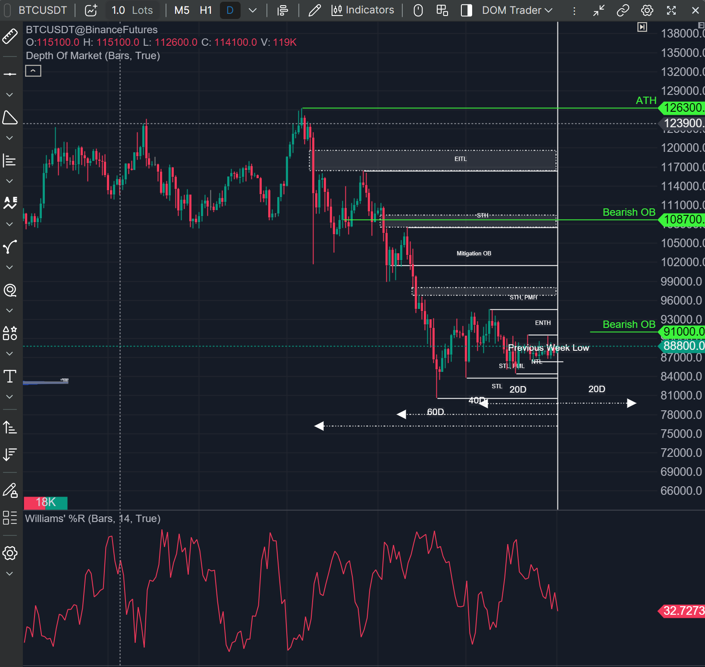
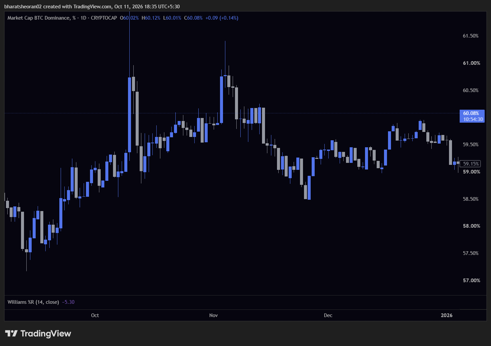
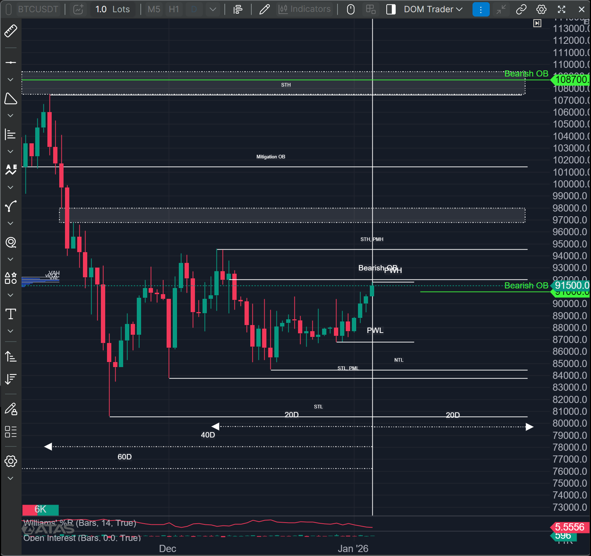
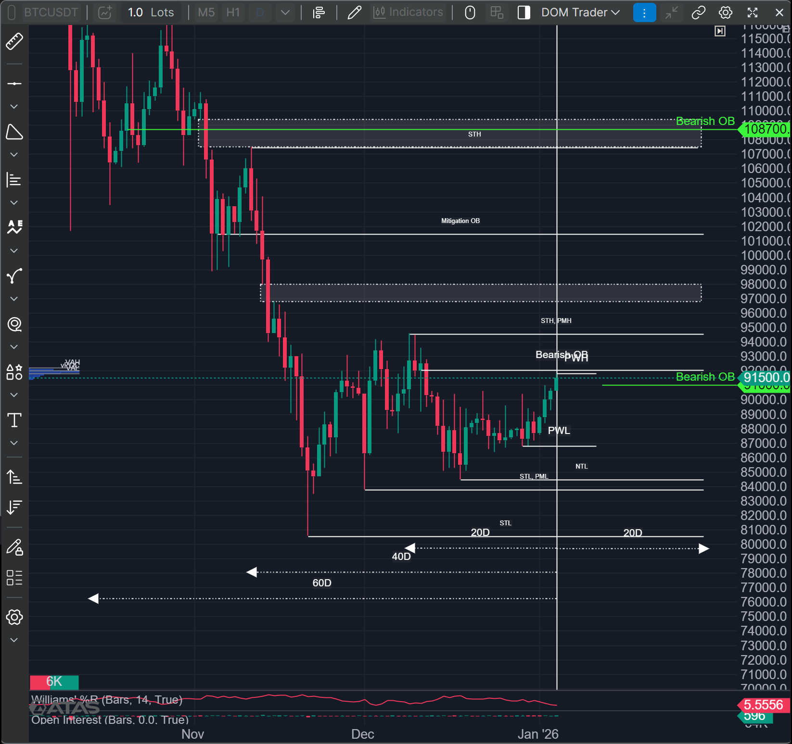

# 📆 Weekly Bias — Week of 5 Jan to 9 Jan (January 2026)

  

> Top-down weekly bias review — filled in before the week starts, revisited as the week develops.

---

## 🧭 Quick Summary

| Symbol | Net Bias |
|---|---|
| Bitcoin |  |
| Gold |  |
| BNBUSD | |
| Nifty | |
| Sensex | |

---

<!-- #region Bitcoin -->

<h3>₿ Bitcoin</h3>

### 💪 Relative Strength
> Relative strength is going Downwards, making LL & LH. going Downwards.

### 📑 Commitment of Traders
> No COT data availaible

### 🎭 Market Sentiment
> The "Bullish Reset" Narrative, As Bitcoin is near the Previous Higher Low, expecting a Bull run for Higher High, but for now consolidation phase is there

### 📊 Market Profile
> There is consolidation from previous 5 Weeks

### 🔗 Intermarket Analysis
> BTC is going down.

### 🏗️ Market Structure
> From weekly perspective, Market is in Consolidation

### 🧩 PD Array Matrix
> PWH & PWL  
Bearish OB  

#### IPDA Range PD Arrays
> ATH -> All time High @ 126,300  

**60 Days**
> FVG b/w @ 119,700 to @ 116,400  
Equal Intermediate Term High @ 116400  
Weekly Bearish OB @ 108,700  
FVG b/w @ 109,400 to @ 107,500  

**40 Days**
> Short Term High @ 107,500  
Mitigation OB @ 101,600  
FVG b/w @ 98,000 to @ 96,700  

**20 Days**
> Near Term Low @ 83,700  

### 🧠 Weekly Bias Defined
> Weekly bias is consolidation or bearish, No Longs for this week

<!-- #endregion -->
---

<!-- #region Gold -->

<h3>🥇 Gold</h3>

### 💪 Relative Strength
> Gold is in -34.77 William Relative Strength, Means it's in Premium Zone  

### 📑 Commitment of Traders
> Commercials are selling the bought Holdings.

### 🎭 Market Sentiment
> The predicted market sentiment for gold leading into January 2027 and Q1 2027 is broadly bullish

### 📊 Market Profile
> Bullish

### 🔗 Intermarket Analysis
> USDX was in Strong Downtrend and is expected to go down in upcoming week  
As USDX and Gold are Inversely correlated, Another Bullish Signal

### 🏗️ Market Structure
> Uptrend, HH HL

### 🧩 PD Array Matrix
> Gold  

### 🧠 Weekly Bias Defined
> All Variables are showing Bullish Bias

### IPDA Range PD Arrays
**60 Days**
> All in 40 Days IPDA

**40 Days**
> Short Term Low @ $3,928  
Mitigation OB @ $4,195  

**20 Days**
> Near Term High @ $4,550  
Near Term Low @ $4,163  
FVG Also

<!-- #endregion -->
---

<!-- #region Etherium -->

<h3>🔶 Etherium</h3>

### 💪 Relative Strength
> Etherium is in Buying Zone according to Relative Strength.

### 📑 Commitment of Traders
> Commercials are buying the Holdings.

### 🎭 Market Sentiment
> Predicted Market Sentiments was Bullish

### 📊 Market Profile
> Bearish

### 🔗 Intermarket Analysis
> Bitcoin was in Bearish trend

### 🏗️ Market Structure
> LL and LH

### 🧩 PD Array Matrix
> Etherium  
Monthly PD Arrays + 1 Bullish OB @ $2512.7  

### 🧠 Weekly Bias Defined
> Trend is Bearish, but we can see accumulation from OTE.

### IPDA Range PD Arrays
**60 Days**
> ITH @4299  
Rejection Block @4157  
Mitigation Block @3747  

**40 Days**
> STH @3660  
STL @2163 

**20 Days**
> NTH @3452  
NTL @2771  

<!-- #endregion -->

---

<!-- #region Nifty -->

<h3>🇮🇳 Nifty</h3>

### 💪 Relative Strength
> Nifty is in Overbought Zone, we can expect a bearish week here

### 📑 Commitment of Traders
> There is NO COT, but in december, FII is at net selling.

### 🎭 Market Sentiment
> All signs shows bearish signs

### 📊 Market Profile
> Bearish

### 🔗 Intermarket Analysis
> India VIX is at 9.5 expecting low volatility in markets

### 🏗️ Market Structure
> HH and HL and in Premium zone right now

### 🧩 PD Array Matrix
> Liquidity Void is Added into the PD Arrays

### 🧠 Weekly Bias Defined
> Weekly bias is bearish.

### IPDA Range PD Arrays
**60 Days**
> ITL @ 24589Rs  
Liquidity Void @ 24400Rs  

**40 Days**
> STL @ 25313Rs  
Liquidity Void @ 25767Rs  

**20 Days**
> NTL @ 25688Rs  

<!-- #endregion -->

---

<h2>🇮🇳 Sensex</h2>

### 💪 Relative Strength
> 

### 📑 Commitment of Traders
> 

### 🎭 Market Sentiment
> 

### 📊 Market Profile
> 

### 🔗 Intermarket Analysis
> 

### 🏗️ Market Structure
> 

### 🧩 PD Array Matrix
> 

### 🧠 Weekly Bias Defined
> 

